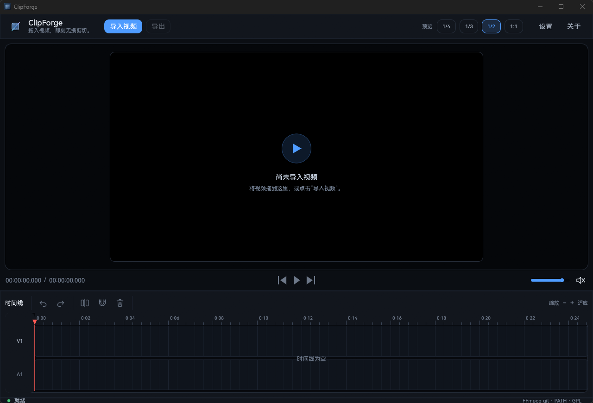

# ClipForge

拖入视频，即刻无损剪切。用 Rust + egui 写的 Windows 桌面视频剪辑工具。



## 技术栈

| 层 | 选型 |
|---|---|
| 语言 / 构建 | Rust 1.85+（edition 2021，`rust-toolchain.toml` 固定 stable） |
| GUI | egui / eframe 0.37，wgpu 后端 |
| 媒体处理 | FFmpeg sidecar CLI（`ffmpeg` + `ffprobe`），不链接 `ffmpeg-next` |
| 音频输出 | cpal 0.18 |
| i18n | rust-i18n 4.2（YAML 文案） |
| 系统主题 | dark-light 3 |
| 文件对话框 | rfd 0.18 |
| 配置目录 | directories 6 |
| 图标 / 打包 | 自研 `xtask`（resvg 栅格化、NSIS 安装包、zip 免安装包） |

## 特性

**导入与预览**

- 拖入文件或「打开方式」启动，后台 ffprobe 解析元数据并建立关键帧索引
- 预览播放带声音，音频作为主时钟；逐帧步进（快速 seek 与帧精确 seek 两种）
- 四档预览画质（1/4、1/3、1/2、1:1），降低档位让拖动和播放更流畅
- 解码在 worker 线程，UI 线程只上传纹理；内存帧缓存（96MB LRU）让回访区域瞬时命中

**时间线编辑**

- 分割、移动、裁剪左右边缘、合并、删除，全部可撤销/重做（200 步快照栈）
- 吸附到时间线起点、播放头、其他片段边缘与帧网格；拖动时显示参考线，Esc 取消
- 自适应刻度、滚轮锚点缩放、Shift+滚轮水平滚动、双击适应全项目
- 跨片段播放自动切换解码源

**导出**

- **无损导出**：`-c copy` 流复制，不损失任何画质。剪切点会吸附到关键帧，导出前把实际入出点与漂移量显示给你
- **多段无损拼接**：逐段导出 MPEG-TS 再用 concat demuxer 合并，兼容性逐项预检，不一致时一键改用精确导出
- **精确导出**：重新编码，剪切点精确到帧，空隙自动补黑场与静音
- 编码器跟随容器：mp4/mov/mkv → H.264 CRF 18 + AAC 192k，webm → VP9 + Opus
- 实时进度（流动条纹）、速度与剩余时间可读、随时取消、先写 `.part` 再原子改名

**其他**

- 简体中文 / English 双语，浅色 / 深色 / 跟随系统主题，均即时生效并持久化
- 缺失 FFmpeg 时显示排查卡片而非崩溃；状态栏显示引擎版本、来源与许可

## 使用

### 直接使用

从 [Releases](https://github.com/TonySen1/clipforge/releases) 下载：

- **安装版** `ClipForge-<version>-win64-setup.exe` —— 安装到当前用户目录，带开始菜单快捷方式与卸载项
- **免安装版** `clipforge-<version>-x86_64-pc-windows-msvc.zip` —— 解压即用，删除目录即卸载

### 前置依赖：FFmpeg

需要 **FFmpeg 6.0+** 或任意较新的 git 构建，且 `ffmpeg` 与 `ffprobe` 位于同一目录。查找顺序：

1. 偏好文件中的显式路径（目录或可执行文件均可）
2. `clipforge.exe` 同级目录的 `bin/`
3. 应用资源目录
4. 系统 `PATH`

推荐直接装到 `PATH`，或把 `ffmpeg.exe` / `ffprobe.exe` 放进取名为 `bin` 的子目录。

精确导出需要 `libx264`（WebM 需要 `libvpx-vp9` 与 `libopus`）；缺失时程序会降级或明确报错。

### 基本流程

1. 拖入视频（或点「导入视频」）
2. 在时间线上拖动、裁剪或分割出需要的片段
3. 点「导出」，确认输出路径、容器与模式
4. 无损模式会显示吸附后的实际剪切点；跨片段且参数不一致时改用精确导出

### 快捷键

| 键 | 作用 |
|---|---|
| Space | 播放 / 暂停 |
| S | 在播放头处分割所选片段 |
| M | 与相邻片段合并 |
| Delete / Backspace | 删除所选片段 |
| Ctrl+Z / Ctrl+Shift+Z | 撤销 / 重做 |
| ← / → | 逐帧后退 / 前进 |
| Shift+← / → | 逐秒后退 / 前进 |
| Ctrl+E | 打开导出对话框 |
| 双击轨道区 | 时间线适应全部内容 |
| Esc | 取消正在进行的拖拽 |

鼠标：拖动片段主体移动，拖左右边缘裁剪，点击或拖动标尺定位播放头。
时间线区域滚轮上下 = 以鼠标为锚点缩放；Shift+滚轮 = 水平滚动；Ctrl+滚轮同样缩放；中键拖动平移。

### 偏好文件

```text
Windows: %APPDATA%\ClipForge\ClipForge\config\preferences.json
macOS:   ~/Library/Application Support/io.ClipForge.ClipForge/preferences.json
Linux:   ~/.config/clipforge/preferences.json
```

## 二次开发

### 环境

```bash
rustup show                     # 确认 stable 工具链
cargo run -p cf-app             # 开发运行，首次编译 eframe/wgpu 需要几分钟
```

### 工程结构

```text
crates/
  cf-core/     纯领域层：时间类型、错误、偏好、FFmpeg 封装、领域模型。不依赖任何 UI
  cf-ui/       设计系统：主题 tokens、i18n、可复用组件与弹窗。不启动进程、不改项目状态
  cf-app/      应用壳：窗口布局、状态机、worker 接线、二进制入口
assets/
  logo/        Logo 与图标 SVG 源
  icons/       由 xtask 生成的 PNG / ICO
  icons/ui/    界面图标源；`*-mask.png` 为现成品牌位图，栅格化时转单色剪影
  fonts/       HarmonyOS Sans SC 与许可
docs/          README 截图
locales/       en.yml / zh-CN.yml
xtask/         图标栅格化、检查与打包
tests/         测试素材与 ffprobe fixture
```

依赖方向严格单向：`cf-app → cf-ui → cf-core`。

### 常用命令

```bash
cargo test --workspace                       # 单元测试（不需要 FFmpeg）
cargo run -p xtask -- check                  # fmt + clippy(-D warnings) + test，CI 等价
cargo run -p xtask -- icons                  # 由 assets/logo/*.svg 重生成应用图标
cargo run -p xtask -- ui-icons               # 由 assets/icons/ui/* 重生成界面图标
cargo run -p xtask -- package                # release 构建 + 便携目录 + zip + 安装包
```

真实 FFmpeg 集成测试默认 `#[ignore]`：

```bash
cargo test -p cf-core --test export_integration -- --ignored
cargo test -p cf-core --test export_p6_integration -- --ignored
```

### 修改界面文案

所有用户可见文本走 `locales/*.yml`，代码里用 `tr("key")`。新增文案必须同时加进 `en.yml`
与 `zh-CN.yml`，否则 `crates/cf-ui/tests/i18n_consistency.rs` 会失败——它同时校验两套 key
完全一致、每个 `tr("...")` 字面量都有翻译。

### 修改颜色

所有颜色集中在 `crates/cf-ui/src/theme/tokens.rs`，UI 层不允许出现 `Color32::from_rgb` 等硬编码。
同一份 i18n 测试会扫描源码拦截违规。

### 打包

```bash
cargo run -p xtask -- package
```

产物在 `dist/`：

```text
clipforge-<version>-<target>/                 便携目录
clipforge-<version>-<target>.zip              免安装版
ClipForge-<version>-win64-setup.exe           安装包（需要 NSIS；缺失时跳过并提示）
```

安装包由 `xtask` 生成 NSIS 脚本后调用 `makensis`，安装到 `%LOCALAPPDATA%\Programs\ClipForge`，
普通用户权限即可。FFmpeg 不随包分发（GPL 原因，详见 `THIRD_PARTY.md`）。

## 已知限制

- 音频轨是视频轨的镜像显示，不渲染波形，也不能独立编辑
- 多选、框选、复制粘贴未实现；合并产生的分组不能解散
- 拖动片段时不做实时碰撞回弹：拖到重叠位置松手才被拒绝并给出原因
- **无损剪切只能落在关键帧上**；**无损拼接要求各段参数完全一致**，否则请用精确导出
- 容器时长可能比视频内容长约 130ms，这是 AAC initial padding 在流复制下的固有行为
- 精确导出的编码参数固定在 H.264 CRF 18 / preset medium / AAC 192k（webm 为 VP9 + Opus）
- 设置页没有 FFmpeg 路径输入框，只能通过偏好文件或 `PATH` 指定
- 打包脚本只生成当前平台产物；仅在 Windows 11 上做过端到端验收

## 许可

ClipForge 采用 GPL-3.0-or-later，见 `LICENSE`。第三方组件与 FFmpeg 分发说明见 `THIRD_PARTY.md`。
