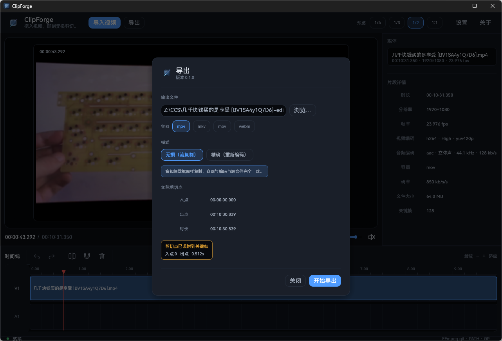
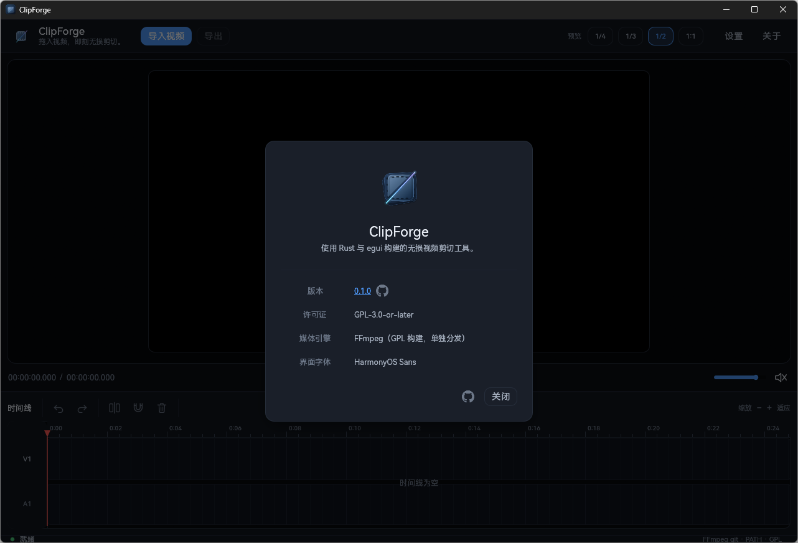

# ClipForge

拖入视频，即刻无损剪切。用 Rust + egui 写的跨平台 GUI 视频剪辑工具。

功能已完整实现（P0–P7）。当前版本 0.1.0，Windows 上验收通过。


<table>
  <tr>
    <td width="50%"></td>
    <td width="50%"></td>
  </tr>
  <tr>
    <td align="center">导出：路径可编辑、容器快切、实际剪切点与漂移</td>
    <td align="center">关于：版本号与 GitHub 图标均可直达仓库</td>
  </tr>
</table>

## 状态

| 阶段 | 内容 | 状态 |
|---|---|---|
| P0 | 骨架：主题 / 语言 / Logo / 布局 | ✅ |
| P1 | 探测与导入：ffprobe、元数据、关键帧 | ✅ |
| P2 | 预览与播放：seek、`-re` 播放、逐帧 | ✅ |
| P3 | 时间线导航：clip 渲染、缩放、滚动、seek | ✅ |
| P4 | 编辑：分割/移动/裁剪/合并/删除/吸附/撤销 | ✅ |
| P5 | 无损单段导出：流复制、漂移预检、进度与取消 | ✅ |
| P6 | 多段与精确导出：兼容性预检、concat、重编码 | ✅ |
| P7 | 收尾：i18n/主题审计、打包、文档、验收 | ✅ |

## 运行

需要 Rust 1.85+（`rust-toolchain.toml` 已固定 stable）。

```bash
cargo run -p cf-app
```

首次编译 eframe/egui/wgpu 需要几分钟。

常用命令：

```bash
cargo test --workspace                          # 单元测试
cargo run -p xtask -- check                     # fmt + clippy + test（CI 等价）
cargo run -p xtask -- icons                     # 由 assets/logo/*.svg 重生成图标
cargo run -p xtask -- package                   # 生成 dist/ 便携分发包
```

集成测试需要真实 FFmpeg，默认忽略：

```bash
cargo test -p cf-core --test export_integration -- --ignored
cargo test -p cf-core --test export_p6_integration -- --ignored
```

## 快捷键

| 键 | 作用 |
|---|---|
| Space | 播放 / 暂停 |
| S | 在播放头处分割所选片段 |
| M | 与相邻片段合并 |
| Delete / Backspace | 删除所选片段 |
| Ctrl+Z / Ctrl+Shift+Z | 撤销 / 重做 |
| ← / → | 逐帧后退 / 前进 |
| Shift+← / → | 逐秒后退 / 前进 |
| Ctrl+E | 打开导出对话框 |
| 双击轨道区 | 时间线适应全部内容 |
| Esc | 取消正在进行的拖拽 |

鼠标：拖动 clip 主体移动，拖左右边缘裁剪，点击或拖动标尺定位播放头（拖出时间线区域也不会中断）。
时间线区域**滚轮上下 = 以鼠标为锚点缩放**；Shift+滚轮或触控板横向滑动 = 水平滚动；Ctrl+滚轮（触控板捏合）同样缩放。

工具栏右侧有**预览质量**选择（1/4 / 1/3 / 1/2 / 1:1）。降低档位会缩小解码分辨率，拖动和播放更流畅；
1:1 用于判断画面细节。选择会持久化。

分割 / 合并 / 删除 / 撤销 / 重做这五个按钮位于时间线左上角，与时间线放在一起，因为它们都作用于时间线。

## 已实现（P0）

- 三栏布局：顶部工具栏、中央预览区 + 播放控制条、底部可拖拽调整高度的时间线。
- **主题**：浅色 / 深色 / 跟随系统，切换即时生效并写入偏好文件；跟随系统时每秒检测一次系统主题变化。
  所有颜色集中在 `crates/cf-ui/src/theme/tokens.rs`，UI 层不出现硬编码颜色。
- **多语言**：简体中文 / English 两套文案，全部走 i18n key，切换即时生效并持久化。
  缺失 key 回退英文。
- **界面字体**：优先 HarmonyOS Sans，其次 Microsoft YaHei，最后 egui 内置字体。
  查找顺序见 `crates/cf-ui/src/fonts.rs`，可用环境变量 `CLIPFORGE_FONT` 指定字体文件。
- **关于页**：版本号与 GitHub 图标均可点击，直达项目仓库（`https://github.com/TonySen1/clipforge`）。
- **Logo**：多层胶片 + 切割光束的矢量图，提供浅色版、深色版、透明工具栏标记与 16–1024 px 图标（含 `.ico`）。
  关于页随主题切换浅色/深色版本。
- 拖入文件时全窗口高亮提示；文件选择器带视频扩展名过滤。
- 状态栏显示当前状态、所选字体与阶段标记。

偏好文件位置：

```text
Windows: %APPDATA%\ClipForge\ClipForge\config\preferences.json
macOS:   ~/Library/Application Support/io.ClipForge.ClipForge/preferences.json
Linux:   ~/.config/clipforge/preferences.json
```

## 已实现（P1）

- **FFmpeg 定位**：按「设置路径 → exe 同级 `bin/` → 应用资源目录 → `PATH`」顺序查找，启动时后台探测，一次 `-version` 与一次 `-encoders`。
  git 版构建（`N-xxxxx`）视为受支持；release 版要求 6.0+。
  记录是否 `--enable-gpl`，以及 libx264 / libx265 / libvpx-vp9 / aac / libopus 是否可用。
- **元数据探测**：`ffprobe -show_format -show_streams` 解析为 `MediaInfo`，包含时长、分辨率（含旋转后的显示尺寸）、帧率（VFR 回退到 `r_frame_rate`）、编码与 profile、像素格式、声道/采样率/音轨码率、容器、整体码率、文件大小。
- **关键帧索引**：`ffprobe -skip_frame nokey` 读取视频流关键帧时间戳，提供「前一个/后一个/最近的」查找与区间吸附（无损导出预检将直接使用）。
- **后台导入**：探测与关键帧扫描都在独立线程，通过 channel 回报，UI 线程不做任何进程 I/O。
  重复路径会被忽略；关键帧读取失败时素材仍可用，只标记为「无法无损导出」。
- **源列表与详情面板**：选中项高亮、载入中占位行、无需音轨提示、旋转角度标注。
- **缺失 FFmpeg 引导**：找不到引擎时预览区替换为带排查信息的卡片，状态栏红点提示，导入被拦下。
- 支持命令行传入文件（`clipforge.exe video.mp4` / 「打开方式」）。

## 已实现（P2）

- **单帧解码**：`ffmpeg -ss <t> -i <src> -frames:v 1 -vf scale -f rawvideo -pix_fmt rgba`。
  实测冷 seek 约 85 ms（1080×1920 HEVC → 406×720）。
  「上一帧/下一帧」使用双 `-ss` 精确 seek，避免落到前一个关键帧。
- **连续播放**：常驻 `ffmpeg -re` 进程读 `rawvideo` 管道，由 FFmpeg 按源帧率自行限速。
  实测 2.02 秒输出 59 帧（≈29.5 fps，源为 30 fps），UI 侧不需要自建帧时钟。
- **worker 架构**：seek 在 worker 线程；播放独占一个线程，停止用 `AtomicBool`，一帧内退出。
  UI 线程只做纹理上传，从不解码、从不阻塞。
- **过期帧丢弃**：每个请求带 generation，UI 丢弃不属于当前请求的帧，「最新请求胜出」自然成立。
- **分辨率与旋转**：解码前按 `preview_max_height` 缩放（按长边），并把旋转元数据烘焙进像素
  （`transpose` 滤镜），因此竖屏手机视频按竖屏显示、比例正确。
- **界面**：画面按原始宽高比 letterbox 显示，左上角叠加时间码；播放/暂停图标随状态切换；
  无画面时显示「正在载入画面…」。
- 退出时向两个 worker 发送 Shutdown，子进程随 `Drop` 被 kill + wait，不留僵尸。

## 已实现（P3）

- **领域模型**：`Project` 持有 sources / tracks / clips / playhead；`Track` 保证按时间排序且不重叠，
  插入冲突直接拒绝。音频轨目前是镜像显示轨，不独立编辑。
- **时间线坐标**：`TimelineView` 是纯值类型（µs↔px、可视范围、滚动钳制、以鼠标为锚点缩放），
  全部逻辑有单元测试，不依赖 egui。
- **刻度自适应**：主刻度按 ~90px 间距从 0.04s 到 30min 的候选序列里选，太小的小刻度自动隐藏，
  亚秒级显示毫秒。
- **渲染**：V1/A1 双轨、圆角 clip 块（选中高亮 + 左侧强调条）、超出视口自动裁剪、
  宽度不足时隐藏标签、空格位置保留底色。
- **交互**：点击/拖动标尺 seek（拖动用快速 seek，松开补一次精确 seek）、点击 clip 选中、
  滚轮/Shift+滚轮水平滚动、Ctrl+滚轮以鼠标为锚点缩放、双击轨道区适应全项目、
  中键拖动平移。
- **播放头联动**：播放时按源时间换算回时间线时间推进播放头；播放中自动滚动保持可见；
  用户手动滚动后停止自动跟随。
- **跨片段**：播放头跨越 clip 边界时自动切换预览解码源；素材列表点击会跳到该素材的首个 clip。

## 已实现（P4）

- **编辑命令**（`cf-core/domain/edit.rs`，全部纯函数）：分割、移动、裁剪左右边缘、删除、合并。
  每条命令要么产生合法时间线，要么返回结构化错误并保持原状——这让撤销变成简单的快照。
  不变式：同轨不重叠、`0 <= source_in < source_out <= 素材时长`、至少一帧长、不引用缺失素材。
- **撤销/重做**（`cf-core/domain/undo.rs`）：Project 全量快照栈，上限 200 条，label 存 i18n key，
  新操作清空 redo 分支。失败的编辑不会进入历史。
- **吸附**（`cf-ui/widgets/snap.rs`）：吸附到时间线起点、播放头、其他 clip 的边缘、帧网格；
  阈值 8 px 随缩放换算成时间。拖动时用被拖 clip 的两条边一起参与吸附，因此对接很自然。
- **拖拽编辑**：拖动 clip 主体移动、拖左右边缘裁剪；拖动中用幽灵位置预览（不写项目），
  松手才提交一次，整个手势只占一个撤销步。拖动时显示吸附参考线，Esc 取消。
- **合并语义**：同源且源区间连续 → 真正合并成一个 clip；不同源 → 建立分组，
  保留两个 clip 与接缝，一起选中和移动（与方案文档一致）。
- **快捷键**：Space 播放/暂停、S 分割、Delete 删除、M 合并、Ctrl+Z 撤销、Ctrl+Shift+Z 重做、
  ←/→ 逐帧（Shift 为逐秒）。用 `consume_key` 精确匹配修饰键组合。
- 工具栏提供分割/删除/合并/撤销/重做按钮，按可用状态自动禁用。

## 已实现（P5）

- **命令构建**（`cf-core/media/export.rs`）：`-ss` 前置快速定位 + `-c copy` + `-avoid_negative_ts make_zero`，
  音轨用 `-map 0:a:0?` 以容忍无音轨素材。
- **关键帧预检**：入点向前吸附到关键帧、出点向后吸附，导前就把实际入出点与漂移量显示给用户，
  而不是导完才发现结果不一样。关键帧不可用时直接阻止导出并给出原因。
- **`.part` 临时文件**：先写到隐藏的 `.name.ext.part`，成功才原子重命名。
  因为双扩展名会让 FFmpeg 猜不出容器，命令里显式传 `-f mp4/mov/matroska/webm`。
- **进度与取消**：`-progress pipe:1` 解析 `out_time_us`；stderr 由独立线程持续读取（否则管道写满会死锁）；
  取消通过 50ms 轮询标志后 kill 并删除临时文件。
- **对话框**：输出路径（默认 `<原名>-edited.<原扩展名>`）、无损模式说明、实际剪切点、漂移警告、
  失败原因与可展开的 FFmpeg 日志。
- 关闭对话框不会中断正在运行的导出；结束后回到状态栏提示。
- 集成测试（`crates/cf-core/tests/export_integration.rs`，默认 `#[ignore]`）用真实 FFmpeg 验证：
  编码集不变、时长符合预期、无音轨素材可导出、取消后无残留文件。

## 已实现（P6）

- **时间线切片**（`export::timeline_pieces`）：把任意时间线窗口切成有序的「片段 / 空隙」列表。
  空隙带自己的起止时间，所以填充时不需要再推算。
- **兼容性预检**（`export::compat`）：对比各段的视频编码、profile、宽高、像素格式、帧率、SAR，
  以及音频编码、采样率、声道（含"一边有音轨一边没有"）。逐项列出差异，并在对话框里直接给出
  「改用精确导出」按钮。
- **多段无损拼接**：每段先 `-c copy` 导出为 MPEG-TS 中间文件，再用 `concat` demuxer 以 `-c copy`
  合成。TS 不需要重写索引，是这里唯一不会引入二次封装损失的选择。中间目录在结束或取消时删除。
- **精确导出**（`export::precise`）：`trim`/`setpts`/`scale`/`pad`/`setsar`/`fps` 逐段归一化，
  再 `concat` 滤镜合并。空隙用 `color=black` + `anullsrc` 生成；没有音轨的源也会合成静音轨，
  否则 concat 会因为音轨数量不匹配失败。
- **编码器选择跟随容器**：webm → VP9 + Opus，mp4/mov/mkv → H.264 (CRF 18) + AAC 192k。
  libx264 缺失时降级到 mpeg4 而非直接失败。
- **进度跨阶段**：多段导出时进度条按「已完成段 + 当前段」推进，不会每段归零。

## 已实现（P7）

- **i18n 审计**（`crates/cf-ui/tests/i18n_consistency.rs`）：校验两套语言的 key 集合完全一致、
  源码里每个 `tr("...")` 字面量都有翻译、以及动态拼接的 key（主题/语言/导出模式/阻断原因/字段名）
  都存在。
- **主题审计**：所有颜色集中到 `theme/tokens.rs`。该测试还会扫描 UI 源码，
  拒绝 tokens 之外出现的 `Color32::from_rgb` / `from_black_alpha`。本轮把散落的
  11 处硬编码色（弹窗遮罩、阴影、舞台文字、clip 标签）全部收进 tokens，并为浅色主题
  单独调整了遮罩透明度与 clip 文字色。
- **打包**（`cargo run -p xtask -- package`）：release 构建后组装便携目录，
  含 exe、字体与字体许可、README.txt（FFmpeg 配置指引）、THIRD_PARTY.md。
- **`cargo run -p xtask -- check`**：一次跑完 fmt / clippy(`-D warnings`) / test。
- README 补齐快捷键表、已知限制、测试与打包说明。

## 预览音频与性能

- **音频**：预览播放有声音。FFmpeg 预解码为 48kHz 立体声 f32 PCM（8 秒素材约 141ms），
  经 cpal 输出；音频作为主时钟校准画面，避免长时间播放漂移。
  播放/拖动后音频会**等首帧上屏才启动**，所以不会出现"声音先走"。
  无输出设备时静默降级，状态栏会提示原因。
- **帧缓存**：seek 结果按「源 + 帧号」缓存在内存中（默认 96MB，LRU）。
  拖动时回访同一区域会直接命中，省掉一次 FFmpeg 进程启动（约 79ms）。
- **seek 成本构成**（实测 1080p HEVC）：进程启动约 79ms、解码约 30ms。
  硬件加速（d3d11va）因初始化开销反而更慢，故未启用。
- 尚未实现**代理文件**（导入时转低码率预览副本），这是进一步降低 seek 延迟的方向。

## FFmpeg 依赖

按 ADR-002 以 **sidecar CLI**（`ffmpeg` / `ffprobe`）方式调用，不链接 `ffmpeg-next`。

需要 FFmpeg **6.0+** 或任意较新的 git 构建，且 `ffmpeg` 与 `ffprobe` 在同一目录。查找顺序：

1. 设置中的显式路径（目录或可执行文件均可）；
2. 可执行文件同级目录的 `bin/`，然后是同级目录本身；
3. 应用资源目录；
4. 系统 `PATH`。

启动时会在状态栏显示实际版本、来源和许可（`GPL` / `LGPL`）。缺失时会显示排查卡片而不是崩溃。

许可策略为 **GPL 构建**：ClipForge 本身以 GPL-3.0-or-later 开源，分发时随附含 libx264 的 FFmpeg GPL 构建。
细节见 `THIRD_PARTY.md`。

## 目录结构

```text
crates/
  cf-core/     纯领域层：时间类型、错误、偏好；不含任何 UI 依赖
  cf-ui/       设计系统：主题 tokens、i18n、可复用组件、弹窗
  cf-app/      应用壳：布局、状态、控制器、二进制入口
assets/
  logo/        SVG 源文件（app-icon / logo-light / logo-dark / mark-neutral / mark）
  icons/       xtask 生成的 PNG 与 .ico
  icons/ui/    界面图标源（SVG；`*-mask.png` 为现成品牌位图）
  fonts/       HarmonyOS Sans SC Regular + 许可
docs/          README 截图
locales/       en.yml / zh-CN.yml
xtask/         图标栅格化与打包
tests/         测试素材（P1 起使用）
```

依赖方向严格单向：`cf-app → cf-ui → cf-core`。UI 层不启动进程、不直接改项目状态。

## 已知限制

功能边界（MVP 有意不做）：

- 音频轨是视频轨的镜像显示，不渲染波形，也不能独立编辑。
- 多选、框选、复制粘贴未实现。
- 合并产生的分组只能一起移动，不能解散。
- 拖动 clip 时不做实时碰撞回弹：可以拖到重叠位置，松手才被拒绝并给出原因。

行为特性（不是 bug）：

- **无损剪切只能落在关键帧上**。导出对话框会先显示实际入出点与漂移量。
- **无损拼接要求每段参数完全一致**（编码/profile/分辨率/像素格式/帧率/SAR/音频参数）。
  任何一项不同都会阻止导出并给出逐项差异，同时提供「改用精确导出」按钮。
- **容器时长可能比视频内容长 ~130ms**，这是 AAC initial padding 在流复制下的固有行为。
- 多段无损拼接会多做一次 MPEG-TS 封装，文件通常比源略大。
- 只索引第一个视频流的关键帧；多视频流文件取流 0。

实现限制：

- 精确导出的编码参数固定在 H.264 CRF 18 / preset medium / AAC 192k（webm 时 VP9 + Opus），
  尚未开放到 UI 调整。
- 设置页没有 FFmpeg 路径输入框；只能通过偏好文件 `ffmpeg_path` 或 `PATH` 指定。
- 字体仅内置 HarmonyOS Sans SC 一个字重，粗体由 egui 合成。
- 打包脚本只生成当前平台的目录；macOS `.app` 与 Linux AppImage 尚未实现。
- 仅在 Windows 11 上做过端到端验收。

## 测试

```bash
# 单元测试（不需要 FFmpeg）
cargo test --workspace

# 全部检查（fmt + clippy + test），等价于 CI
cargo run -p xtask -- check

# 真实 FFmpeg 集成测试（默认 #[ignore]）
cargo test -p cf-core --test export_integration -- --ignored
cargo test -p cf-core --test export_p6_integration -- --ignored
```

测试资产：

- `tests/fixtures/ffprobe/*.json` — ffprobe 的真实输出，用于解析器回归。
- `tests/fixtures/media/` — 对应素材：H.264+AAC、VP9 无音轨、带 90° 旋转元数据。
- `crates/cf-ui/tests/i18n_consistency.rs` — 校验两种语言的 key 集合一致、
  所有 `tr("...")` 字面量都有翻译、且 UI 层没有 tokens 之外的硬编码颜色。

## 打包

```bash
cargo run -p xtask -- package
```

输出到 `dist/clipforge-<version>-<target>/`，包含可执行文件、字体（含许可）、README.txt
（含 FFmpeg 配置说明）、`LICENSE` 与 `THIRD_PARTY.md`。FFmpeg 不随包分发，原因见 `THIRD_PARTY.md`。

同时生成：

- `dist/ClipForge-<version>-win64-portable.zip` —— 免安装版，解压即用。
- `dist/ClipForge-<version>-win64-setup.exe` —— 安装包（若本机装有 NSIS；否则跳过并提示）。

## 许可

ClipForge 采用 GPL-3.0-or-later。第三方组件见 `THIRD_PARTY.md`。
